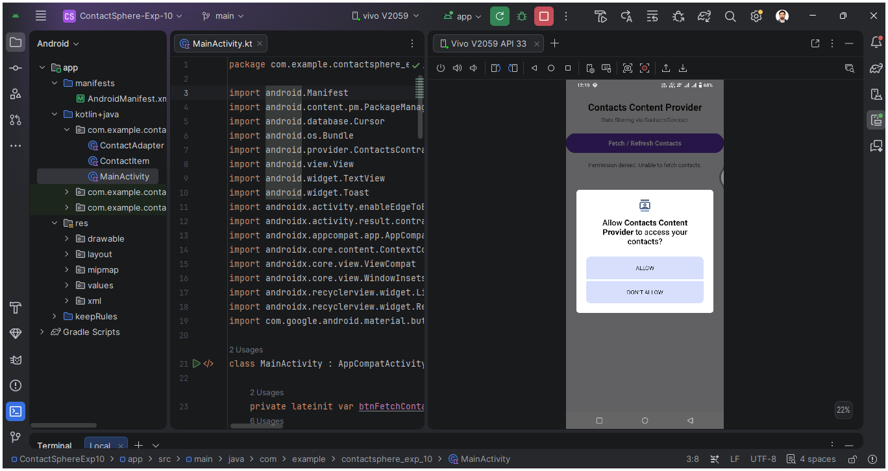
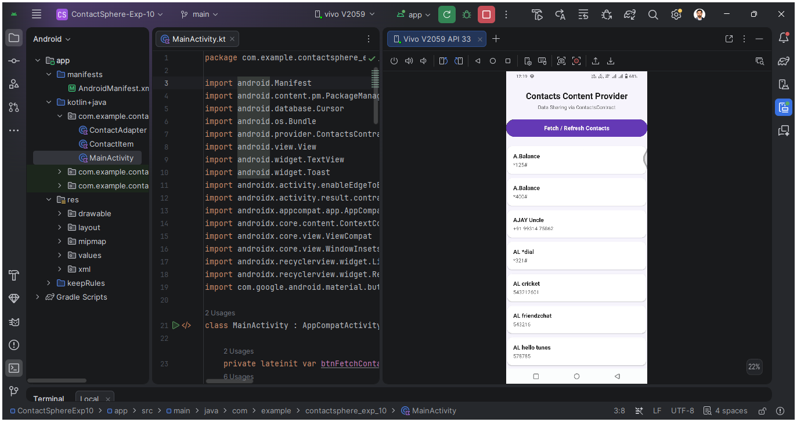

# MAD Experiment 10: Data Sharing Using Contacts Content Provider

## Aim
To implement data sharing in an Android application using the Contacts Content Provider to retrieve and display contact names and phone numbers.

## Description
**Contacts Content Provider** is an Android application developed using Kotlin and XML with a clean, purple-themed interface. It demonstrates how an app can request permission to access device contacts and retrieve contact information using `ContentResolver` and `ContactsContract`.

## Technologies Used
- Android Studio
- Kotlin
- XML layouts
- Android Contacts Content Provider
- `ContentResolver`
- `ContactsContract`
- Runtime permissions

## Features
- Simple purple-themed user interface
- Runtime permission request for reading contacts
- Fetch and refresh contacts using a button
- Display contact names and phone numbers
- Show an appropriate message when no contacts are available
- Handle denied permission without crashing

## Project Structure
```text
exp10/
├── app/
│   └── src/
│       └── main/
│           ├── java/com/example/exp10/
│           │   └── MainActivity.kt
│           ├── res/
│           │   └── layout/
│           │       └── activity_main.xml
│           └── AndroidManifest.xml
├── screenshots/
│   ├── 1_Contacts_Permission.png
│   └── 2_Contacts_Screen.png
└── README.md
```

## Source Code

### 1. Contacts Permission
Add the following permission above the `<application>` element in `AndroidManifest.xml`:

```xml
<uses-permission android:name="android.permission.READ_CONTACTS" />
```

The app must also request this permission at runtime before reading contacts.

### 2. Contacts Content Provider
The app uses `ContentResolver` with `ContactsContract.CommonDataKinds.Phone.CONTENT_URI` to query contact names and phone numbers.

```kotlin
contentResolver.query(
    ContactsContract.CommonDataKinds.Phone.CONTENT_URI,
    arrayOf(
        ContactsContract.CommonDataKinds.Phone.DISPLAY_NAME,
        ContactsContract.CommonDataKinds.Phone.NUMBER
    ),
    null,
    null,
    ContactsContract.CommonDataKinds.Phone.DISPLAY_NAME + " ASC"
)?.use { cursor ->
    while (cursor.moveToNext()) {
        val name = cursor.getString(0) ?: "Unknown Contact"
        val number = cursor.getString(1) ?: "No phone number"
        // Display name and number in the app UI.
    }
}
```

## Screenshots

| 1. Contacts Permission | 2. Contacts Screen |
|---|---|
|  |  |

## Working
1. Launch the app.
2. Tap **Fetch / Refresh Contacts** (or follow the app's initial permission request).
3. Grant contact-reading permission when Android asks.
4. The app queries the device contacts and displays available names and phone numbers.
5. If the device has no saved contacts, the app displays **No contacts found on device.**
6. Tap the button again to refresh the list.

## How to Run
1. Open the `exp10` project in Android Studio.
2. Wait for Gradle sync to complete.
3. Run the app on an Android emulator or connected Android device.
4. Grant the contacts permission when prompted.
5. Tap **Fetch / Refresh Contacts** to load the contact list.
6. To see contact entries, ensure the emulator or phone has saved contacts.

## Privacy Note
The application requests `READ_CONTACTS` permission because it needs access to the device's contacts. Contact information is read locally and displayed in the app; only grant permission when you are comfortable allowing this access.

## Author
**Vishwajeet Singh**  
**USN:** 25MCAR0219  
**JAIN DEEMED TO BE UNIVERSITY**

## Result
Successfully implemented data access using Android's Contacts Content Provider to retrieve and display contact information after obtaining runtime permission.
